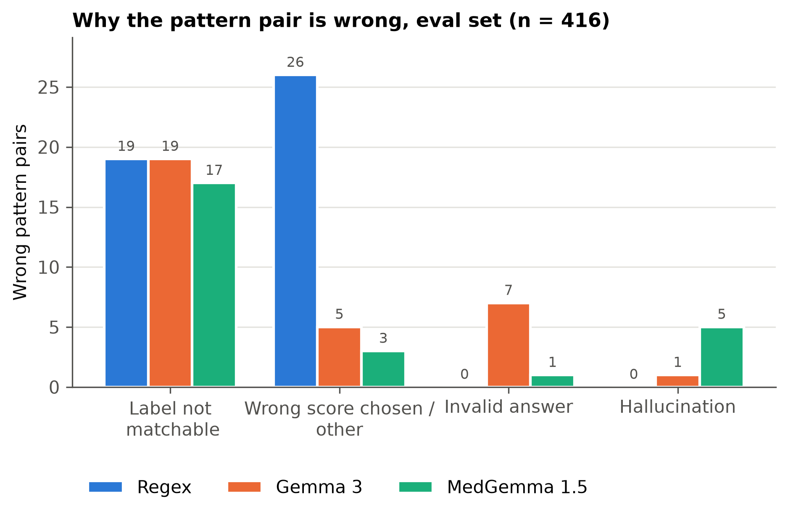

# GleasonExtraction

**Does Medical Domain Tuning Help? MedGemma 1.5 vs. Gemma 3 for Extracting Gleason Scores from Prostate Cancer Pathology Reports**

Course project for TDT13 at NTNU.

When a prostate is examined for cancer, the pathologist's free-text report gives a Gleason score: the two most common tissue patterns, each graded 1–5, written as e.g. `3 + 4 = 7`. The phrasing varies a lot (`GLEASON SCORE 7 (4+3)`, `Primary pattern: 3/5, Secondary pattern: 4/5`, ...), and the reports are scanned documents turned into text with OCR, so they contain typos and noise.

This repository compares three ways of extracting the primary and secondary pattern from such reports:

1. **Regex baseline**: hand-written regular expressions.
2. **MedGemma 1.5 4B-it** ([`google/medgemma-1.5-4b-it`](https://huggingface.co/google/medgemma-1.5-4b-it)), a Gemma 3 model tuned on medical text and images.
3. **Gemma 3 4B-it** ([`google/gemma-3-4b-it`](https://huggingface.co/google/gemma-3-4b-it)), the general model MedGemma is built on.

Both language models are used **zero-shot** with the identical prompt and decoding settings, with no fine-tuning.

## Data

- **Reports:** the 446 prostate (TCGA-PRAD) reports from [TCGA-Reports](https://github.com/jkefeli/tcga-path-reports) (Kefeli et al., 2024), used as they are, with no cleaning of the OCR text.
- **Labels:** `GLEASON_PATTERN_PRIMARY`, `GLEASON_PATTERN_SECONDARY` and `GLEASON_SCORE` from the TCGA clinical data on [cBioPortal](https://www.cbioportal.org/study/summary?id=prad_tcga) (study `prad_tcga`), joined on the patient ID. Every report has a label.
- **Split** (seed 13, stratified on the score): **30 tuning reports**, used to develop the regex and the prompt, and **416 eval reports**, used only for the final runs.
- Score 7 is 237 of the 446 reports; score 10 has only 4.

## Results

All numbers are on the 416 eval reports (`results/eval/v1`–`v3`). Brackets are 95 % bootstrap intervals.

| Method | Accuracy (score) | Macro-F1 | Pattern-pair exact match | Pair exact match, 397 reachable reports | Invalid | Not found | Hallucinations |
|---|---|---|---|---|---|---|---|
| Regex | 0.928 [0.904, 0.950] | 0.858 | 0.892 [0.861, 0.921] | 0.935 | 0 | 4 | 0 |
| Gemma 3 4B-it | 0.945 [0.923, 0.964] | **0.931** | 0.923 [0.897, 0.947] | 0.967 | 7 | 2 | 1 |
| MedGemma 1.5 4B-it | **0.962** [0.942, 0.978] | 0.915 | **0.938** [0.913, 0.959] | **0.982** | 1 | 0 | 5 |

- **Both language models beat the regex** (McNemar's exact test on the pattern pair: MedGemma p = 0.0005, Gemma 3 p = 0.03).
- **MedGemma is ahead of Gemma 3, but the difference is not significant.** On the pattern pair, 10 reports are right only for MedGemma and 4 only for Gemma 3 (p = 0.18).
- **Macro-F1 favours Gemma 3 only because of score 10**, which has 4 reports. On every other score MedGemma's F1 is equal or higher.
- **19 eval reports cannot be matched by any method.** In some the report states a different score than the label. In 6, the label is the earlier biopsy score rather than the prostatectomy score. In 2, the report contains no Gleason score at all. The "reachable" column leaves these 19 out.
- **The models fail differently:**
  - Gemma 3 misreads notation where the total comes first ("GLEASON SCORE 7 (3+4)" becomes `{"primary": 7, ...}`), which gives its 7 invalid answers.
  - MedGemma never answers "not found". Its 5 hallucinations, checked by hand, are mostly "3+4", the most common score, including on the 2 reports that have no score.
  - The regex mostly fails when a report has several scores, e.g. an earlier biopsy score in the clinical history.



More figures are in [`figures/`](figures/): F1 per score and the confusion matrices. Tables are there too: the main table, the paired tests, and every wrong answer with its cause.

### Setup choices

- **Same prompt and decoding for both models:** greedy decoding, `max_new_tokens=1024`, no input truncation (the longest prompt is 2,878 tokens). The full prompt is saved in every run's `v<N>_config.json`.
- **Reasoning blocked:** MedGemma 1.5 writes a reasoning block before its answer by default. It was blocked by banning the `<unused94>` token, and the same ban was applied to Gemma 3.
- **Several scores in one report:**
  - The regex takes the highest score.
  - The prompt instead asks for the overall score of the examined specimen in the final diagnosis, not scores from earlier biopsies or the clinical history.
- **The prompt was not changed after the tuning runs** (`results/tuning/v1`, `v2`).

## Repository structure

```
data/
  prostate_reports.csv   446 reports with labels and the tuning/eval split (made by 01_data)
  raw/                   downloads, not committed (re-created by 01_data)
notebooks/
  01_data.ipynb          download reports and labels, join, split
  02_regex.ipynb         regex baseline
  03_llm.ipynb           MedGemma 1.5 / Gemma 3 extraction (needs a GPU)
  04_analysis.ipynb      tables, statistics and figures from the logged runs
  common.py              shared loading, answer parsing, metrics and run logging
results/
  tuning/, eval/         one folder per subset of reports
    v<N>.csv             one row per report: raw output, parsed answer, status, label
    v<N>_config.json     every setting of the run, including the full prompt
    v<N>_scores.json     metrics and confusion matrix
    runs.csv             one row per run (rebuilt automatically)
figures/                 figures (PNG, PDF) and tables (CSV) for the report
```

Every run is logged as the next free `v<N>` and old runs are never overwritten, so each number above can be traced to the exact configuration and raw model outputs that produced it.

| Run | Method | Subset |
|---|---|---|
| `results/eval/v1` | Regex | eval |
| `results/eval/v2` | Gemma 3 4B-it | eval |
| `results/eval/v3` | MedGemma 1.5 4B-it | eval |
| `results/tuning/v1` | Gemma 3 4B-it | tuning |
| `results/tuning/v2` | MedGemma 1.5 4B-it | tuning |

## Requirements

- **Python 3.11** with:
  - pandas, numpy, scikit-learn, scipy and matplotlib, for all notebooks;
  - torch, transformers (≥ 5), huggingface_hub and accelerate, for `03_llm.ipynb` only;
  - Jupyter, or any editor that runs notebooks.

  The runs were made with pandas 3.0.6, numpy 2.4.6, scikit-learn 1.9.1, scipy 1.17.1, matplotlib 3.11.2, torch 2.14.0+cu126, transformers 5.17.0, huggingface_hub 1.33.0 and accelerate 1.15.0.
- **A CUDA GPU for `03_llm.ipynb`.** The 4B models in bfloat16 need about 9 GB of GPU memory for the weights, so a GPU with 16 GB or more is a safe choice. One run over the 416 eval reports took about 6 minutes. The other notebooks run on a CPU in seconds.
- **A Hugging Face account that has accepted the licenses** of both [MedGemma 1.5](https://huggingface.co/google/medgemma-1.5-4b-it) and [Gemma 3](https://huggingface.co/google/gemma-3-4b-it), and an access token stored on the machine (`hf auth login`). The weights (about 8.6 GB per model) are downloaded to the Hugging Face cache the first time `03_llm.ipynb` runs.
- **Internet access** for `01_data.ipynb` (GitHub and the cBioPortal API) and for the first model download.

On a cluster whose GPU driver supports at most CUDA 12.x (such as NTNU's IDUN), install a CUDA 12 build of torch. A plain `pip install torch` may install a CUDA 13 build that cannot see the GPU:

```bash
pip install "torch==2.14.0" --index-url https://download.pytorch.org/whl/cu126
pip install "transformers>=5" huggingface_hub accelerate pandas numpy scikit-learn scipy matplotlib jupyter
```

## How to run

Run the notebooks from the `notebooks/` folder, in order. Each notebook starts with an imports cell and a `config` cell, and all settings that can change between runs are in `config`. Set `log_run=False` to try something without saving a run.

1. **`01_data.ipynb`** downloads the reports and labels, joins them and writes `data/prostate_reports.csv` with the split. You can skip it if you use the committed CSV. Note that the labels are fetched live from cBioPortal, so the committed CSV is the reference copy.
2. **`02_regex.ipynb`** runs the regex baseline on a CPU. Set `subset` to `"tuning"` or `"eval"`.
3. **`03_llm.ipynb`** needs a GPU. Set `model_id` to `"google/medgemma-1.5-4b-it"` or `"google/gemma-3-4b-it"`, and `subset` to `"tuning"` or `"eval"`. The first cells download the weights if they are missing, load the model and show the prompt and answer for one report. Then it runs the whole subset and logs the run.
4. **`04_analysis.ipynb`** reads the runs listed in its config (by default `eval/v1`–`v3`) and writes the tables and figures to `figures/`. The lists of unmatchable reports and confirmed hallucinations in its config come from reading the reports by hand.

Greedy decoding makes the language-model runs deterministic for a given software and hardware setup. Re-running a configuration logs a new `v<N>` next to the old ones.
